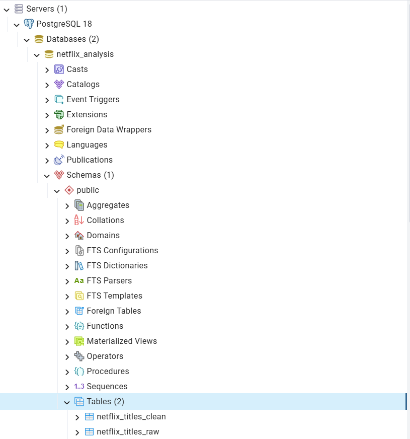
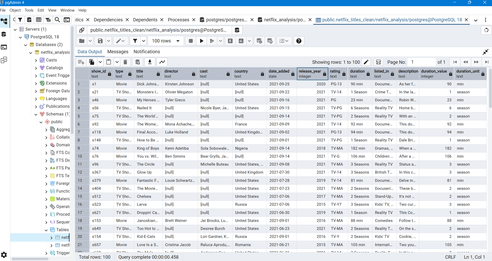
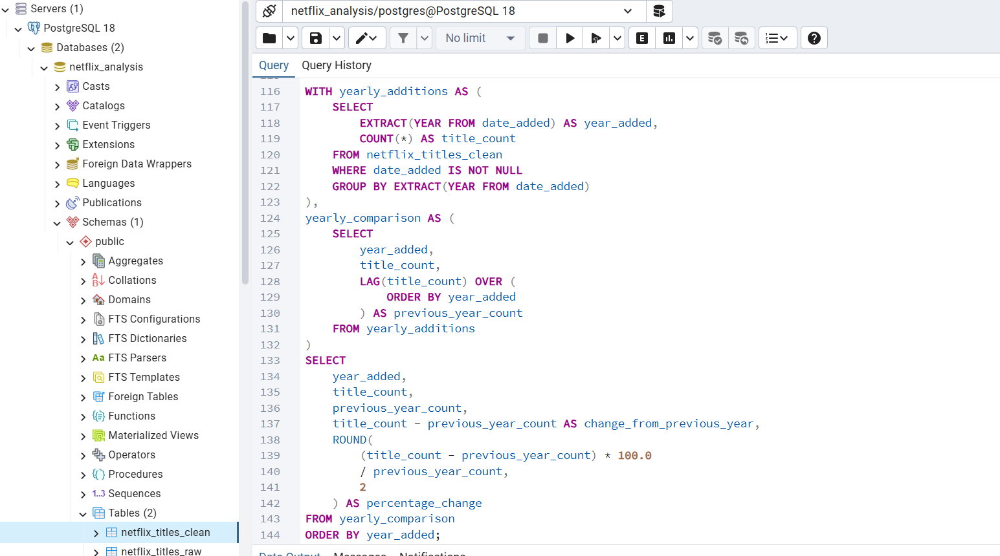
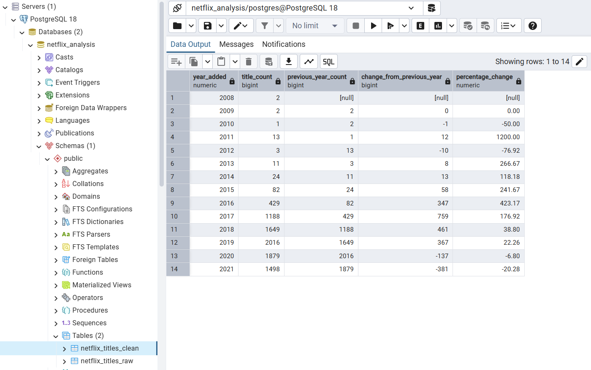
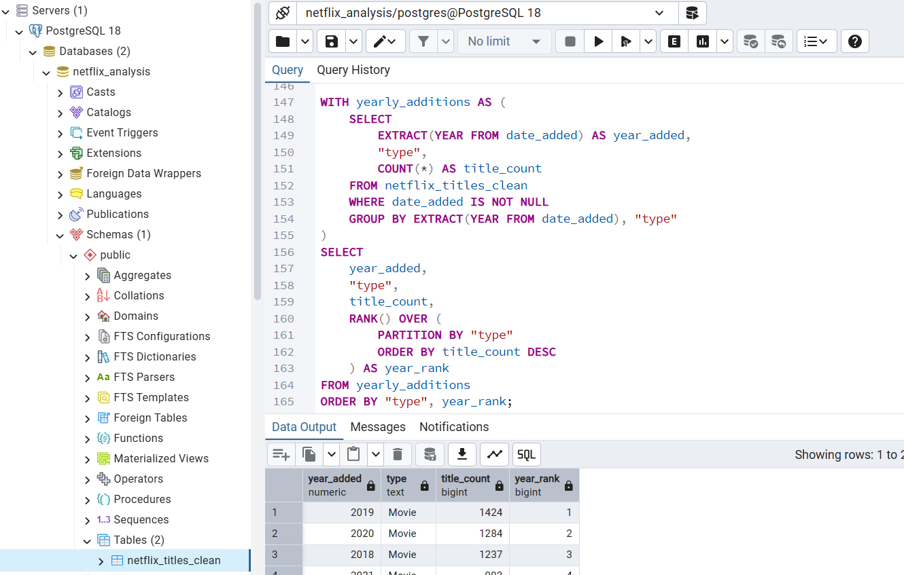
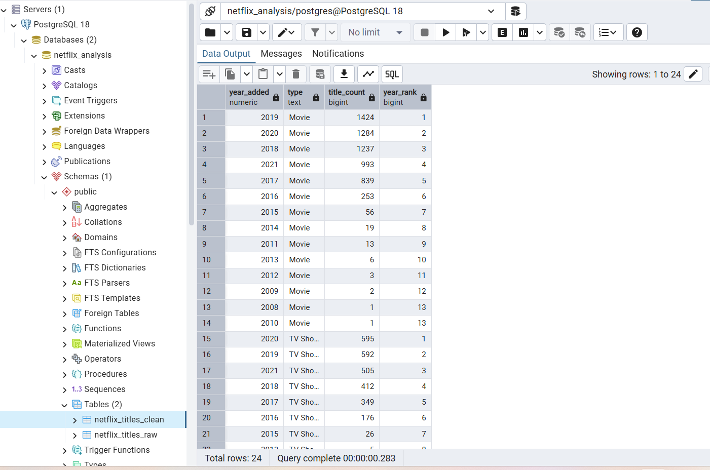
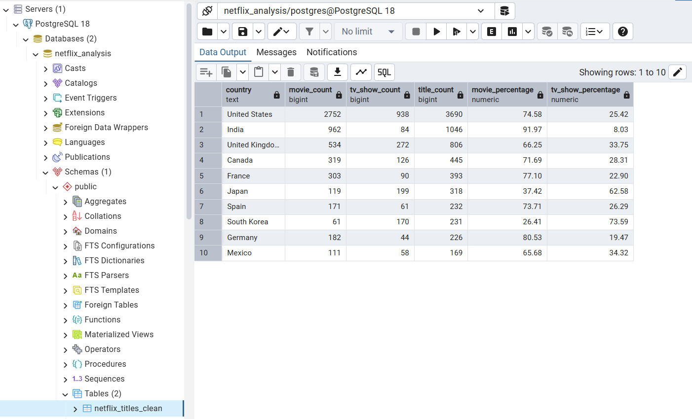
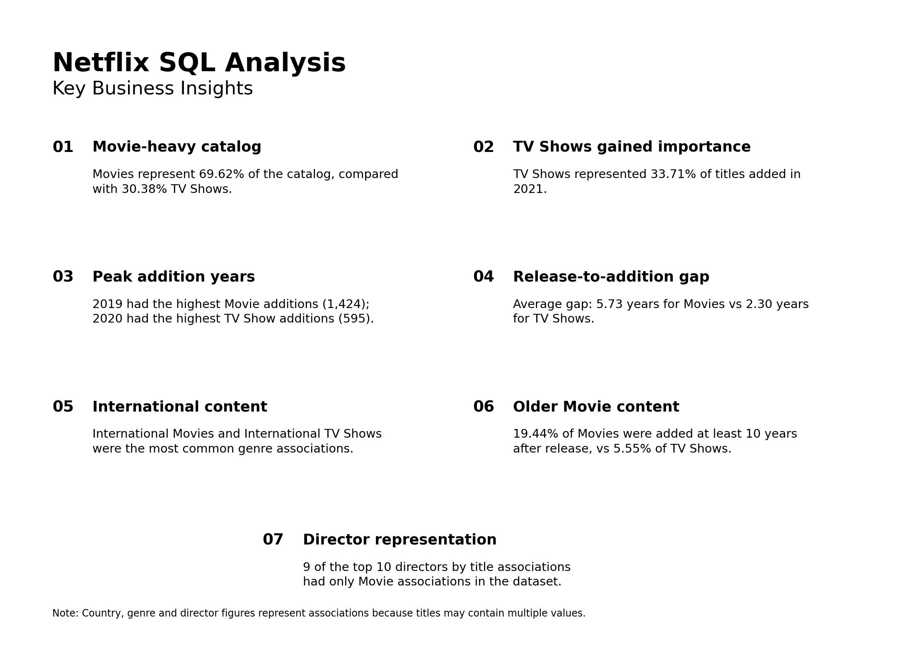

# Netflix Movies & TV Shows — SQL Data Analysis

## 📌 Project Overview

This project analyzes the Netflix Movies and TV Shows dataset using PostgreSQL and SQL.

The objective is to explore Netflix's catalog, identify patterns in content additions, understand differences between Movies and TV Shows, and derive meaningful business insights from the data.

The project focuses on SQL-based data cleaning, exploratory analysis, advanced SQL techniques, and business-oriented analysis.

---

## 🎯 Business Objectives

The analysis aims to answer questions such as:

- What is the composition of Netflix's catalog between Movies and TV Shows?
- How has the catalog changed over time?
- Which ratings, genres, and countries are most represented?
- How do Movies and TV Shows differ in their characteristics?
- Which years experienced the highest number of additions?
- How long after release were titles added to Netflix?
- Which directors are associated with the largest number of titles?
- What business insights can be derived from these patterns?

---

## 📊 Dataset

**Dataset:** Netflix Movies and TV Shows  
**Source:** Kaggle  
**Dataset creator:** Shivam Bansal

The dataset contains information about Movies and TV Shows available in the Netflix catalog, including:

- Title
- Content type
- Director
- Cast
- Country
- Date added
- Release year
- Rating
- Duration
- Genres
- Description

The dataset contains **8,807 records/titles**.

After cleaning, the project retained **8,807 records** in the cleaned table.

---

## 🛠️ Tools & Technologies

- **PostgreSQL 18**
- **pgAdmin 4**
- **SQL**
- **GitHub**

---

## 🗄️ Database Structure

The project uses the following database and tables:

**Database:** `netflix_analysis`

**Tables:**

- `netflix_titles_raw` — original imported dataset
- `netflix_titles_clean` — cleaned dataset used for analysis

---

## 🧹 Data Cleaning

The raw dataset was cleaned before analysis.

Key cleaning activities included:

- Handling missing values
- Cleaning invalid rating values
- Cleaning duration-related data
- Creating a separate cleaned table
- Preserving the original raw dataset for reference

The cleaned table contains **8,807 records**, with **10 NULL values in `date_added`**.

---

## 🔍 Analysis Performed

### 1. Exploratory Analysis

The exploratory analysis examined:

- Movie vs TV Show composition
- Titles by release year
- Content additions over time
- Rating distribution
- Movie duration ranges
- Countries represented in the catalog
- Top titles by release year and content type
- Year-over-year changes
- Cumulative catalog additions
- Country and content-type mix

### 2. Advanced SQL Analysis

Advanced analysis focused on:

- Ranking years by the number of Movies and TV Shows added
- Measuring the gap between original release and Netflix addition
- Comparing genre distributions between Movies and TV Shows
- Measuring the share of titles added at least 10 years after release

### 3. Business Questions

The project also addressed four business-oriented questions:

1. How has the composition of Netflix's catalog changed over the years between Movies and TV Shows?
2. Which content ratings are most common, and how does the rating distribution differ between Movies and TV Shows?
3. Among the top 10 countries by title associations, which countries have a relatively stronger Movie presence versus TV Show presence?
4. Which directors are associated with the largest number of titles, and what is the Movie/TV Show mix of their titles?

---

## 💡 Key Business Insights

### 1. Movie-heavy catalog

Movies represent **69.62% of the titles in the dataset**, compared with **30.38% TV Shows**.

### 2. Growing importance of TV Shows

TV Shows became an increasingly significant part of yearly additions over time. In 2021, they represented **33.71%** of titles added.

### 3. Major addition years

2019 recorded the highest number of Movie additions with **1,424 titles**, while 2020 recorded the highest number of TV Show additions with **595 titles**.

### 4. Difference in release-to-addition timing

The average gap between original release year and Netflix addition was approximately **5.73 years for Movies** and **2.30 years for TV Shows**.

### 5. International content representation

International Movies and International TV Shows were the most common genre associations within their respective content types.

### 6. Older Movie content

**19.44% of Movies** were added at least 10 years after their original release, compared with **5.55% of TV Shows**.

### 7. Director representation

Among the top 10 directors by title associations, the dataset is overwhelmingly Movie-focused. Nine of the top 10 directors had only Movie associations in the dataset.

---

## 📸 Project Screenshots

### Database Setup



### Data Cleaning



### Exploratory Analysis — Year-over-Year Additions

#### SQL Query



#### Result



### Advanced SQL Analysis — Ranking

#### SQL Query



#### Result



### Business Analysis — Country and Content Mix



### Key Business Insights



---

## 🧠 SQL Skills Demonstrated

This project demonstrates practical use of:

- `SELECT`, `WHERE`, `GROUP BY`, `ORDER BY`
- Aggregate functions such as `COUNT()` and `AVG()`
- `CASE WHEN`
- `ROUND()`
- Common Table Expressions (`CTEs`)
- Window functions
- `LAG()`
- `RANK()`
- `SUM() OVER()`
- `PARTITION BY`
- `STRING_TO_ARRAY()`
- `UNNEST()`
- `TRIM()`
- Percentage calculations
- Year-over-year analysis
- Ranking and comparative analysis
- Working with multi-valued text fields

---

## 📁 Project Structure

```text
Netflix-SQL-Analysis/
│
├── data/
│   └── netflix_titles.csv
│
├── sql/
│   ├── 01_database_setup.sql
│   ├── 02_data_cleaning.sql
│   ├── 03_exploratory_analysis.sql
│   ├── 04_advanced_analysis.sql
│   ├── 05_business_questions.sql
│   └── 06_business_insights.sql
│
├── screenshots/
│
└── README.md
```

---

## ⚠️ Analysis Limitations

* The dataset represents a snapshot of Netflix's catalog rather than Netflix's complete historical catalog.
* `date_added` contains 10 NULL values, so analyses based on addition dates exclude those records.
* Country, genre, and director fields can contain multiple values for a single title. Therefore, their counts represent **associations**, not exclusive ownership or classification.
* The release-to-addition gap is calculated using the available `release_year` and `date_added` fields. It should not be interpreted as proof of Netflix's internal acquisition or content strategy.
* The analysis describes patterns in the dataset and does not establish causal relationships.

---

## 📌 Conclusion

This project demonstrates how SQL can be used to move from raw data to structured analysis and business insights.

The analysis combines data cleaning, exploratory analysis, advanced SQL techniques, and business-oriented questions to understand the composition and characteristics of the Netflix catalog.

The project also demonstrates practical experience with PostgreSQL, including CTEs, window functions, ranking, aggregation, and analysis of multi-valued fields.
